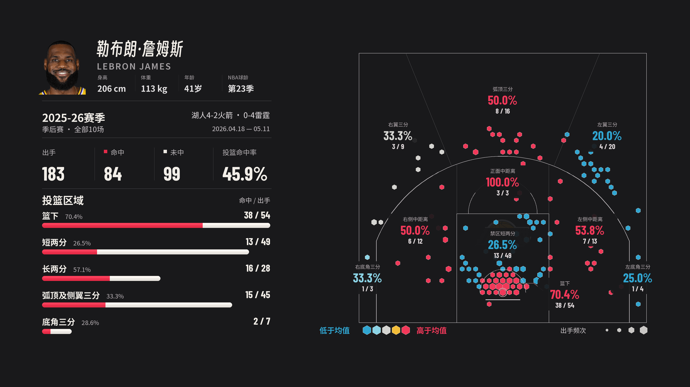

# zone atlas

NBA / CBA 球员区域投篮图 Skill。输入中文或英文姓名、赛季和比赛范围，直接生成3840×2160静态PNG及1920×1080预览。

## 使用

把 `skills/zone-atlas` 放入Agent技能目录（Codex默认 `~/.codex/skills/zone-atlas`），在该技能目录安装 `pip install -r scripts/requirements.txt`。

> 使用 $zone-atlas，做勒布朗2025-26赛季季后赛的区域投篮图。

> 使用 $zone-atlas，做贺希宁2025-26常规赛第1场到第10场的图。

只有姓名时先选择实际可用赛季；支持整季、常规赛、季后赛、总决赛、具体系列赛及实际出场第N至M场。场次包括零出手的真实出场，排除DNP；不能按有坐标的比赛编号冒充实际出场序号。

## 图面

- 头像、中英文名、身高cm、体重kg、比赛期间年龄、对应联盟球龄。
- 赛季短横线，例如2025-26；赛季信息保持两行，真实系列赛比分或选定范围战绩。
- 出手、命中、未中、命中率四列；正常宽度英文名；区域命中率放名称旁，宽松圆角柱条。
- 顶部96／底部144像素安全区（1080高），横向内容重新排版并右移，不整体缩小；去掉右侧标题和右上球队Logo。
- 左侧五区红色命中／白色未中数量柱，总长度是总出手，底角合并。
- 右侧十区半场，左右底角分别统计，左右按球员面向篮筐；六边形大小代表出手频次。
- 蓝、浅蓝、灰白、黄、红五档比较同赛季同阶段联盟同区命中率；总决赛默认对比该季整个季后赛，指定场次常规赛默认对比该季常规赛。可明确另选基准。
- 直接绘制4K静态图，不依赖视频渲染、截图、ffmpeg或投篮轨迹视频技能。

## 数据和缓存

NBA取数脚本使用 [SportsDataverse数据发布](https://github.com/sportsdataverse/sportsdataverse-data/releases/tag/nba_stats_shots)，已验证起点1996-97，具体赛季/球员覆盖按源站实际核验。CBA支持用户已登录的 [CBAstats](https://cbastats.com/) 正常业务数据及现代FIBA几何；不承诺全部CBA历史赛季完整。

优先复用本地全联盟坐标、赛程、身份、头像、队标、字体和统计缓存，缺项再获取。CBA静态图不必额外抓完整投篮时间轴。付费原始数据和登录鉴权不随公开包分发，首次安装需自己的访问权限及缓存。

保留全部真实坐标与重复位置，缺点不随机补造；范围总计须独立核验技术统计。历史三分线变化须先适配几何，不能把现代模板直接套用所有年份。

## 验证

- 勒布朗2025-26季后赛183投84中、10场，独立脚本输出与最终审定4K图像素一致。
- CBA贺希宁612条坐标、五区/十区及左右底角核对通过。
- 测试目录包含零出手真实出场时，第1-2场正确保留该场，不误选第三次出场。

NBA示例逐球、个人资料和素材来源见示例job。字体附原许可证。球员肖像、球队标志及数据保留原始权利，仓库不授予额外素材许可。

完整说明见 [SKILL.md](skills/zone-atlas/SKILL.md)、[数据与范围](skills/zone-atlas/references/data-and-ranges.md)、[制作与job](skills/zone-atlas/references/production.md)。
